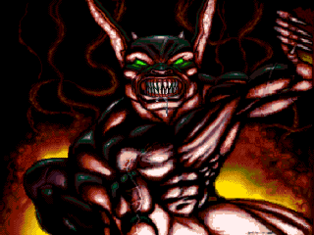
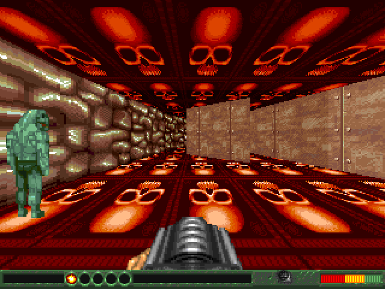
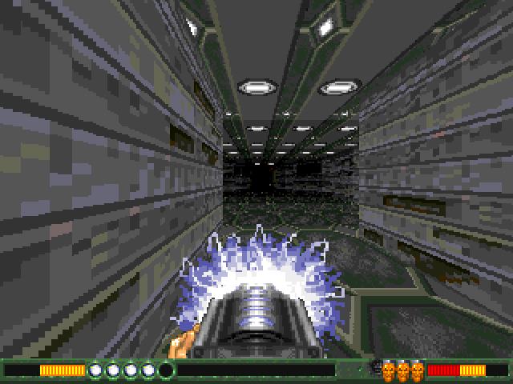
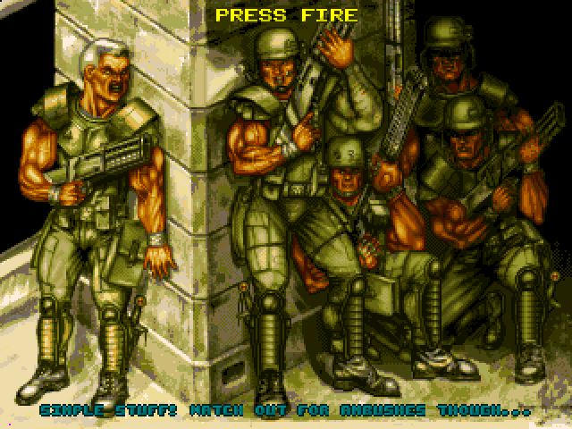

# Gloom — portage Java

*Read this in [English](README.md).*

Portage en Java de **Gloom** (Black Magic Software, Amiga 1995), le premier clone de Doom sorti
sur Amiga. Le moteur est réécrit **ligne à ligne depuis l'assembleur 68020 d'origine**
([earok/GloomAmiga](https://github.com/earok/GloomAmiga)) — pas d'émulateur, pas de
réinterprétation : le code Java suit l'asm instruction par instruction, et les sources `.s`
restent la référence en cas de doute.

Le moteur d'origine est un rasteriseur logiciel qui « dessine » sa scène dans une **copperlist** :
un poke de registre couleur par pixel, que le copper Amiga rejoue à l'écran. Le portage jette ce
chemin d'affichage — il rend dans un framebuffer RGB classique — et garde ce qui compte : la
mémoire, l'arithmétique, les formats de données et les règles du jeu, prises dans l'assembleur
plutôt que redevinées.



Porté par **Guillaume Monet**.

---

## Le rendu

Le rasteriseur d'origine, porté, en 320 × 240 interne : la fidélité au pixel.



> La vue 3D temps réel (jMonkeyEngine, éclairage dynamique, mouselook) est un projet séparé,
> **[gloom-rebirth](https://github.com/guillaumemonet/gloom-rebirth)**, qui compile la simulation de ce projet-ci telle quelle.

Le HUD, les menus et les écrans d'histoire sont ceux du jeu, décodés depuis ses propres données
(images IFF, fonte Amiga à 7 plans) :

| HUD en jeu | Écran d'histoire |
|---|---|
|  |  |

Deux variantes du rasteriseur sont portées : `gloom.s` (chunky, `focshft 6`, FOV large) et
`gloom2.s` (planaire/AGA, `focshft 7` + `castrots128`, projection « Deluxe » moins déformée).
Elles partagent le même rasteriseur : seules la focale et la table de rayons changent.

---

## Les choix du portage

### La RAM 68k comme un simple tableau d'octets

Toute la mémoire du jeu est **un `byte[]` de 64 Mo, gros-boutiste et plat** (`gloom.Mem`). Les
registres `d0-d7`/`a0-a6` deviennent des `int`, et tous les accès passent par des helpers typés
(`Mem.b/w/l`, `ub/uw`, `wb/ww/wl`) qui reproduisent l'ordre des octets et l'arithmétique du 68k.
`gloom.M68k` fait le reste (`swap`, `muls/mulu`, `divs/divu`, extensions de signe, décalages `.w`).

C'est ce qui rend le portage ligne à ligne possible : une structure de l'asm reste à **la même
adresse et au même offset** qu'à l'origine, y compris ses bizarreries. Et il y en a — dans Gloom,
`ob_nxvec` et `ob_lives` sont le **même mot** (`rs.w 0`), tout comme `ob_nzvec` et `ob_infra`.
Un portage « propre » aurait séparé ces champs et cassé silencieusement le jeu.

Le garde-fou : `gradle checkLayout` vérifie que chaque offset de structure correspond au fichier
`.s`. Il doit afficher `TOUT OK`.

### Ce qui n'est PAS porté : la couche matérielle

Le copper, le blitter, la C2P, les registres audio Paula et les interruptions CIA n'ont pas
d'équivalent utile ici. À la place, une **couche hôte** mince : LWJGL 3 (GLFW/OpenGL/OpenAL) sur
PC, les API Android sur téléphone. Le moteur ne la connaît pas.

Le découplage est réel et mesurable : sur les ~13 500 lignes du portage, seuls **quatre fichiers**
dépendent de LWJGL (`host/Main`, `host/Display`, `host/Audio`, `host/DisplayTest`), et l'APK
Android compile les **mêmes sources** que le desktop, sans une ligne dupliquée. Une interface
suffit à isoler l'audio : `AudioBackend` — OpenAL sur PC, `AudioTrack` sur Android.

### L'audio refait à la manière de Paula

Le son n'est pas délégué à une bibliothèque de plus haut niveau. Les échantillons sont au format
Gloom (`[période][longueur en mots][PCM 8 bits signé]`), et la **période Paula** donne la fréquence
de lecture (`3546895 / période`). Côté Android, les 4 voies DMA sont rejouées à la main, avec un
pas en virgule fixe 16.16 et les mêmes règles d'attribution de voie (une libre, sinon la moins
prioritaire, sinon rien) — puis mixées avec la musique dans un unique flux.

La musique MED (MMD0/MMD1) est un lecteur écrit pour le portage : séquenceur + mixeur 4 voies,
le replayer d'origine étant un blob 68k non portable.

### Android : ce que la mesure a appris

Le portage tourne sur téléphone (mesuré sur un Xiaomi : 60 images/s). Un constat non évident,
obtenu en instrumentant plutôt qu'en devinant :

- **La 2D tournait à moitié vitesse** parce que `lockCanvas()` rend un canvas *logiciel* :
  l'agrandissement du framebuffer 320 × 240 vers le plein écran se faisait au processeur.
  `Surface.lockHardwareCanvas()` a suffi (35 → 60 images/s).

---

## Ce qui marche

- **Panneau HUD et arme à l'écran de Gloom Deluxe** : vue 320×224 et panneau 320×16 dessous
  (vie, vies, puissance de l'arme, jauge mega, messages qui défilent), arme avec balancement de marche
  et flamme de tir selon l'arme — lus dans `smallfont2.bin`/`gun.bin` de la disquette et dessinés
  selon le code de `gloom2` Deluxe (`gradle deluxeHudTest`).
- Les **niveaux s'enchaînent** : écran-titre, menu, écrans d'histoire, campagne complète pilotée
  par le script d'origine, points de contrôle et reprise (« CONTINUE FROM… »).
- **Déplacement et collision** suivant les règles de l'asm (glissement le long des murs, écrasement),
  tir des cinq armes avec leurs dégâts, cadences et sons.
- **IA par type** : marine, baldy, terra, ghoul, phantom, demon, lizard, troll — chacun a sa logique
  d'origine (charge, tir, esquive). Boss : le dragon (cercles + missiles à tête chercheuse) et la
  deathhead (aspiration d'âme, qui traîne le joueur vers elle).
- **Gore complet** : étincelles d'impact, 24 gouttes de sang *à chaque coup encaissé*, gibs avec
  gravité, décals persistants au sol, éclaboussure sur la vue quand une goutte frôle la caméra.
- Les monstres **bronchent** quand on les touche : sonnés et intouchables un court instant.
- **Powerups** : arme, thermo, invisibilité, invincibilité « hyper », balles rebondissantes, avec
  leurs timers, leurs messages et leurs avertissements d'expiration.
- **Géométrie dynamique** : portes, polygones en rotation, animations de textures, zones-trigger
  (embuscades, téléports, sortie).
- **Audio** : tous les effets, les voix d'ambiance des monstres, et la musique MED.
- **Android** : APK du moteur 2D, commandes tactiles, disquettes récupérées au premier
  lancement.

## Ce qui manque

- Le **mode 2 joueurs** (lien série modem) et le chat — hors périmètre, comme le reste de `ap.s`.
- Le **mini-jeu Defender** (`combatok`).
- Le fondu du volume de la musique entre les niveaux (`fadevol`).
- Les sons de coup sont fidèles, mais les **voix d'ambiance** de quelques monstres restent à vérifier
  en situation.
- `ob_infra` : vestige de l'original — le bonus « infrarouge » y donne en réalité les lunettes
  thermo, et la variable n'est lue nulle part. Reproduit tel quel.

---

## Lancer le jeu

### Depuis les sources

Les données du jeu sont lues **directement dans les deux disquettes de Gloom Deluxe** (`.adf`),
montées en mémoire — rien n'est extrait sur le disque. Les fichiers compactés Crunch-Mania sont
décompactés à la lecture. Les seuls fichiers embarqués sont les `incbin` de compilation de
`gloom.s` (tables et sprites intégrés, `src/gloom/data/incbin/`), qui font partie des sources.

```
Gloom/
├── adf/            ← Gloom Deluxe (Disk 1 of 2).adf + (Disk 2 of 2).adf
└── gloom-java/     ← ce projet Gradle
```

Les disquettes sont cherchées dans `-Dgloom.adf=<dossier>`, `./adf`, `../adf`, puis
`~/.gloom-java/adf`. Si elles sont absentes, le jeu **propose** de les télécharger depuis
[Amiga Museum](https://amigamuseum.emu-france.info) (deux archives, ~1,4 Mo) — rien sans un oui.
Elles sont reconnues par leur nom de volume (`gloomprog`, `gloomdata`) : la version « [a] » comme
la version « [cr DLM] » conviennent. `gradle checkDisks` les monte sans lancer le jeu.

Puis, depuis `gloom-java/` :

```bash
gradle run                        # partie complète (logo → menu titre → campagne)
gradle run2                       # variante gloom2.s (focshft 7 + castrots128)
gradle run -Dscale=4              # fenêtre plus grande (interne 320×240)
gradle run -Dmap=map1_3 -Dtile=1  # un seul niveau (test/visite)
```

Options : `-Dw= -Dh= -Dscale= -Dmap= -Dtile= -Dengine=gloom2 -Dmedspeed= -Dgloom.adf=`.
Mode développeur : `-Dgloom.assets=../GloomAmiga` lit un dossier (le dépôt GloomAmiga) au lieu des
disquettes.

**Prérequis** : JDK 21 (la toolchain Gradle est figée dessus, et `jpackage` en vient), Gradle 9.x.
Les natives LWJGL sont réglées sur Windows x64 ; pour Linux/macOS, changez `lwjglNatives` dans
`build.gradle` et construisez **sur la plateforme cible**.

**Contrôles** — `W`/`S` ou `↑`/`↓` avancer/reculer, `A`/`D` pas de côté, `←`/`→` tourner, clic
gauche / `Ctrl` / `Espace` tirer et valider, `Échap` quitter.

Au démarrage, la carte graphique utilisée (`GL_RENDERER`) est affichée dans la console.

### Android

L'APK contient le moteur 2D (la 3D a son propre APK dans `gloom-rebirth`). **Pouce gauche** : avancer, reculer, tourner. **Pouce
droit** : pas de côté (◀ ▶) et tir. **Bouton MENU** en haut à droite : recule d'un cran
(partie → menu → quitter), comme la touche retour.

Android 8.0 minimum. Au premier lancement, l'application propose de télécharger les disquettes (réseau nécessaire cette
fois-là seulement).

---

## Comment c'est vérifié

Il n'y a pas de tests unitaires au sens habituel : la référence n'est pas une spécification, c'est
un fichier assembleur. Chaque sous-système a donc son **harnais**, qui rejoue un scénario et
compare le comportement à celui décrit par l'asm. Une trentaine au total, tous dans
`src/gloom/tools/` :

```bash
gradle checkLayout        # disposition mémoire : chaque offset contre le .s
gradle mathTest           # RNG, angles, calcangle
gradle mapTest            # chargement map + textures
gradle goreTest           # sang, gibs, décals, flinch → gore.png
gradle monsterTest        # IA par type de monstre
gradle bossTest           # dragon et deathhead
gradle powerupTest        # powerups, messages, objets animés, aspiration
gradle medTest            # lecteur MED → med1.wav
gradle levelRenderTest    # rend une frame d'un vrai niveau → level.png
```

Chacun affiche `TOUT OK` ou écrit un PNG/WAV de démonstration. `gradle tasks --group verification`
donne la liste complète.

---

## Structure

| dossier | contenu |
|---|---|
| `src/gloom/` | le moteur : `Mem`, `M68k`, `Render`, `Objects`, `Player`, `Map`, `Events`, `Sfx`, `MedPlayer`… |
| `src/gloom/host/` | couche hôte PC (LWJGL) : fenêtre, audio, boucle de jeu, HUD, menus, séquenceur |
| `src/gloom/data/` | sections `.data` de l'asm : tables précalculées, `objinfo` |
| `src/gloom/tools/` | les harnais de vérification |
| `android/` | module Android (compile `../src` tel quel) |
| `src/gloom/boot/` | lecture des disquettes `.adf` (montage, téléchargement proposé) |
| `src/gloom/data/incbin/` | les `incbin` de compilation de `gloom.s` (tables, sprites intégrés) |

---

## Distribution

```bash
gradle jpackage           # app native autonome → build/jpackage/Gloom/Gloom.exe (JRE embarqué)
gradle jpackageInstaller  # installeur natif : .msi (WiX requis), .dmg, .deb
cd android && gradle assembleRelease    # APK Android
```

Le paquet contient l'exécutable, le JRE et les jars — **pas les données** (voir ci-dessous). Au
premier lancement, le jeu trouve les disquettes (`<appli>/adf`, `~/.gloom-java/adf`) ou propose de
les télécharger.

Les binaires prêts à l'emploi sont dans les
[releases](https://github.com/guillaumemonet/gloom-java/releases).

---

## Licence et crédits

*Gloom* est © **Black Magic Software**. Les **sources `.s`/`.bb2` d'origine sont dans le domaine
public** (cf. le dépôt `GloomAmiga`) et constituent la référence de ce portage.

Les **données du jeu** — graphismes, sons, maps — **ne le sont pas** et ne sont **jamais
redistribuées** ici : ni le dépôt, ni le paquet PC, ni l'APK ne les contiennent. Elles sont lues
dans les disquettes de **Gloom Deluxe**, que le jeu propose de récupérer sur
[Amiga Museum](https://amigamuseum.emu-france.info) au premier lancement. Seuls les `incbin` de
compilation de `gloom.s` (tables, sprites intégrés), qui font partie des sources, sont versionnés.

Moteur d'origine : **Black Magic Software** (1995).
Portage Java : **Guillaume Monet**.

Le portage a été mené avec l'assistance d'une IA (Claude, Anthropic) : écriture du code de
traduction, harnais de vérification et instrumentation. Les choix d'architecture, la validation
contre l'assembleur d'origine et le résultat restent ceux de l'auteur.
